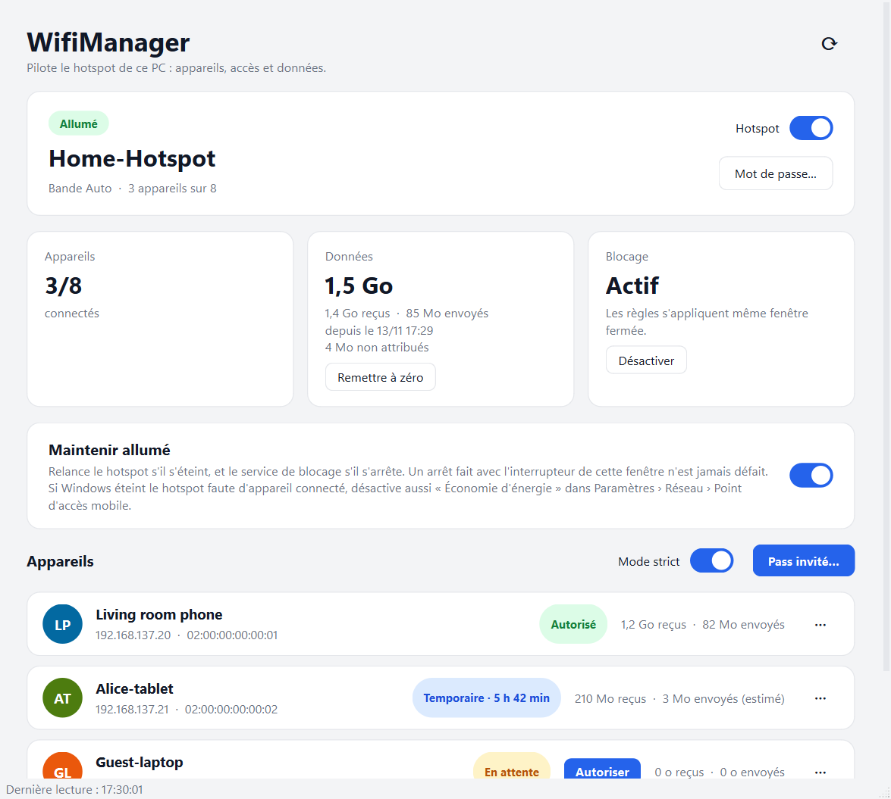
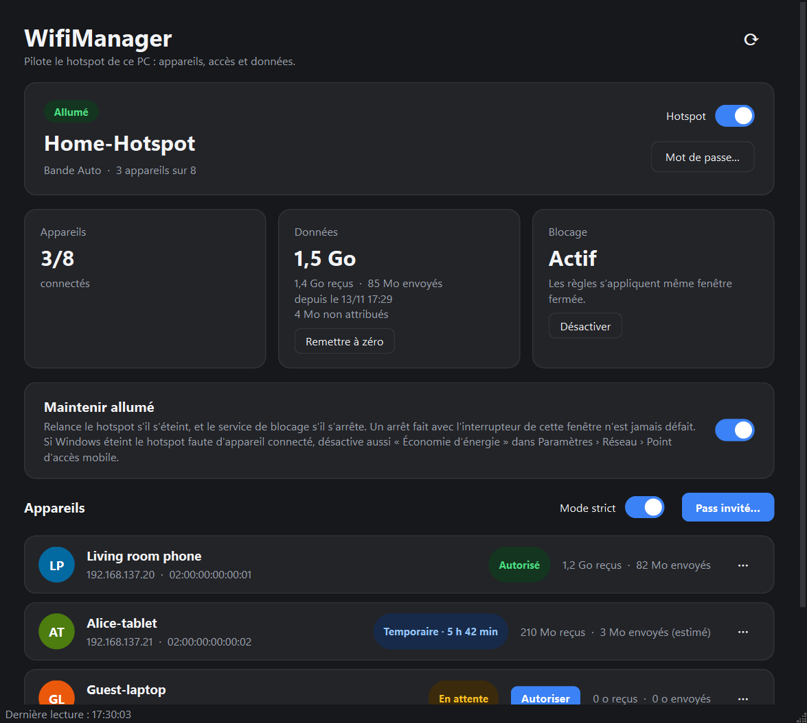

<p align="center"></p>

# WifiManager

Pilote le **hotspot mobile de Windows** depuis une application de bureau moderne : mot de passe en un clic partagé par
QR code, appareils connectés nommables, blocage, accès limités dans le temps (6, 12 ou 24 heures), pass invités,
mesure des données, et maintien du hotspot allumé.

> English: see [README.md](README.md).



<details>
<summary>Thème sombre</summary>



</details>

## Fonctions

- **Hotspot** : état, démarrage et arrêt, nouveau mot de passe en un clic avec **QR code** de connexion.
- **Appareils** : nom, adresses et statut de tout ce qui est connecté, avec les noms que tu choisis.
- **Blocage par appareil** : coupe l'accès à Internet d'un appareil via la plateforme de filtrage de Windows. Vérifié
  sur un vrai PC : l'appareil bloqué ne répond plus, et répond de nouveau une fois libéré.
- **Accès limités dans le temps** : 6 h, 12 h, 24 h ou une durée libre. L'échéance est appliquée par un service en
  arrière-plan : elle tient fenêtre fermée et survit à un redémarrage.
- **Pass invités** : un QR code qui donne une durée d'accès fixe au **premier nouvel appareil** qui s'y connecte, avec un
  mode strict qui retient les nouveaux appareils jusqu'à ton accord.
- **Données** : total du hotspot exact ; par appareil, exact s'il est seul et **estimé** s'ils sont plusieurs (Windows ne
  fournit pas le trafic par appareil).
- **Maintenir allumé** : relance le hotspot s'il s'éteint et le service de blocage s'il s'arrête, avec un délai et une
  limite d'essais pour ne jamais boucler.
- Thèmes clair et sombre qui suivent Windows.

## Prérequis

- Windows 10 ou 11, avec le **Point d'accès mobile** activé dans les Paramètres.
- Python 3.13 ou plus récent.

## Installation et lancement

**Installateur (recommandé)** : télécharge `wifimanager-<version>-windows-setup.exe` sur la
[page des versions](https://github.com/Joselma-Jemk/WifiManager/releases) et vérifie-le avec `SHA256SUMS`. Il demande
les droits administrateur et s'installe volontairement dans `Program Files` : le service de blocage tourne avec des
droits élevés, son dossier ne doit donc pas être modifiable par un simple utilisateur. Un `.zip` portable est aussi
publié. La désinstallation retire la tâche du service et conserve tes réglages.

Signature de code gratuite fournie par [SignPath.io](https://about.signpath.io/), certificat de
[SignPath Foundation](https://signpath.org/). Voir la [politique de signature](docs/CODE_SIGNING_POLICY.md).

Depuis les sources :

```bash
git clone https://github.com/Joselma-Jemk/WifiManager.git
cd WifiManager
python -m pip install -e ".[dev]"
python -m wifimanager.app
```

Le blocage et les accès limités demandent un petit **service en arrière-plan** avec les droits administrateur. Clique
sur **Activer…** dans la tuile *Blocage* : Windows demande ton autorisation une seule fois, puis le service démarre à
chaque ouverture de session. **Désactiver** l'arrête et retire tous les blocages.

## Fonctionnement

| Élément | Rôle | Droits |
|---|---|---|
| Fenêtre (Qt) | affichage et ordres | utilisateur normal |
| Service | applique les règles, bloque, compte les données | administrateur |
| Canal local | fenêtre ↔ service, une ligne JSON par requête | utilisateur Windows courant seulement |

Le service est une tâche planifiée lancée à l'ouverture de session. Les blocages vivent dans une session *dynamique* du
pare-feu : si le service s'arrête, tous les blocages disparaissent, donc rien ne reste bloqué par erreur. Le modèle de
menace est dans [SECURITY.md](SECURITY.md), les notes de conception dans [DESIGN.md](DESIGN.md).

## État et limites

Version préliminaire (0.1). Vérifié sur un vrai PC Windows 11 : lecture du hotspot, blocage par appareil, accès limités
dans le temps, service et canal local, compteurs de données.

**Pas encore vérifié sur un vrai hotspot :** démarrer, arrêter et changer le mot de passe depuis la fenêtre (couverts par
des tests avec un hotspot simulé). Changer le mot de passe déconnecte tous les appareils.

- Windows ne donne pas le trafic par appareil : les données par appareil sont une estimation quand plusieurs sont connectés.
- Un appareil bloqué reste connecté au Wi-Fi, mais n'a plus Internet. Seul un changement de mot de passe le déconnecte.
- Un appareil qui change d'adresse MAC peut passer pour un nouvel appareil.
- L'option « Économie d'énergie » de Windows, qui éteint le hotspot, n'est pas modifiée par l'application ; le maintien
  allumé relance le hotspot quelle que soit la cause.

## Développement

```bash
python -m pip install -e ".[dev]"
python -m pytest
python -m ruff check src tests --select E,F,W,I --ignore E501
```

La plupart des tests tournent partout (Qt hors écran, PowerShell et pare-feu simulés). Ceux qui exigent le vrai
PowerShell ou DPAPI de Windows sont ignorés ailleurs. Voir [CONTRIBUTING.md](CONTRIBUTING.md).

## Contact et licence

contact@joselma.online. MIT, voir [LICENSE](LICENSE).
