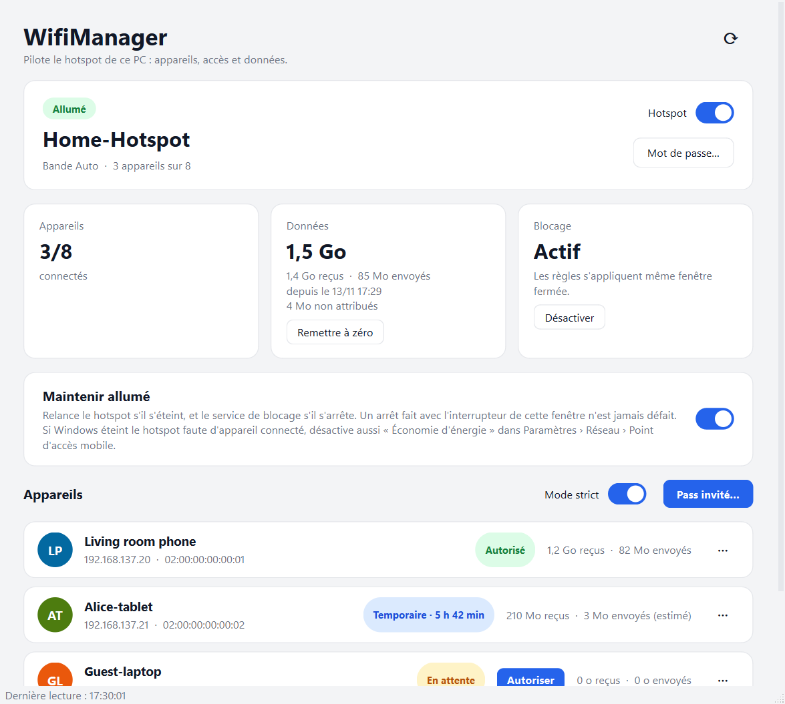
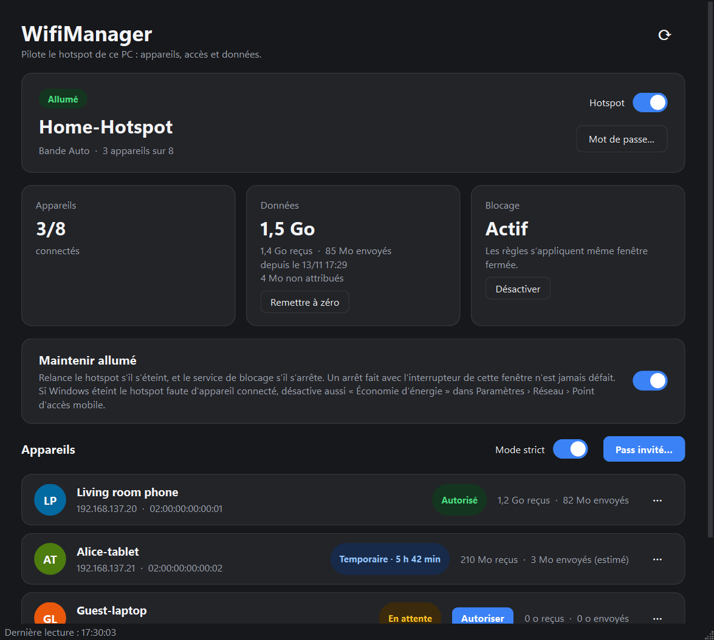

<p align="center"></p>

# WifiManager

Manage the **Windows mobile hotspot** from a modern desktop app: change its password in one click and share it with
a QR code, see and name the connected devices, block them, give time-limited access (6, 12 or 24 hours), hand out
guest passes, measure data usage, and keep the hotspot alive.

> Français : voir [README.fr.md](README.fr.md).



<details>
<summary>Dark theme</summary>



</details>

## Features

- **Hotspot control**: state, start and stop, one-click new password with a Wi-Fi **QR code**.
- **Devices**: name, address and status of everything connected, with names you choose.
- **Blocking per device**: cuts a device off from the Internet through the Windows Filtering Platform. Verified on a
  real PC: a blocked device stops answering and answers again once released.
- **Time-limited access**: 6 h, 12 h, 24 h or a custom duration. The deadline is enforced by a background service, so it
  holds when the window is closed, and it survives a restart.
- **Guest passes**: a QR code that gives a fixed access time to the **first new device** that connects with it, with a
  strict mode that holds new devices until you approve them.
- **Data usage**: exact hotspot total; per device it is exact for a single device and an **estimate** when several share
  the hotspot (Windows does not report per-device traffic).
- **Keep alive**: restarts the hotspot if it turns off, and the blocking service if it stops, with a delay and an
  attempt limit so it never loops.
- Light and dark themes that follow Windows.

## Requirements

- Windows 10 or 11 with the **Mobile hotspot** enabled in Settings.
- Python 3.13 or newer.

## Install and run

**Installer (recommended)**: download `wifimanager-<version>-windows-setup.exe` from the
[Releases page](https://github.com/Joselma-Jemk/WifiManager/releases) and check it against `SHA256SUMS`. It needs
administrator rights and installs into `Program Files` on purpose: the blocking service runs elevated, so its folder
must not be writable by ordinary users. A portable `.zip` is also published. Uninstalling removes the service task and
keeps your settings.

Free code signing provided by [SignPath.io](https://about.signpath.io/), certificate by
[SignPath Foundation](https://signpath.org/). See the [code signing policy](docs/CODE_SIGNING_POLICY.md).

From the sources:

```bash
git clone https://github.com/Joselma-Jemk/WifiManager.git
cd WifiManager
python -m pip install -e ".[dev]"
python -m wifimanager.app
```

Blocking and time-limited access need a small **background service** with administrator rights. Click **Activate…**
in the *Blocking* tile: Windows asks for your approval once, and the service then starts at every sign-in. **Deactivate**
stops it and removes every block.

## How it works

| Part | Role | Rights |
|---|---|---|
| Window (Qt) | display and orders | normal user |
| Service | applies rules, blocks traffic, counts data | administrator |
| Local channel | window ↔ service, one JSON line per request | current Windows user only |

The service is a scheduled task started at sign-in. Blocks live in a *dynamic* firewall session: if the service stops,
every block disappears, so nothing can stay blocked by mistake. See [SECURITY.md](SECURITY.md) for the threat model and
[DESIGN.md](DESIGN.md) for the design notes (in French).

## Status and limits

Early version (0.1). Checked on a real Windows 11 PC: reading the hotspot, per-device blocking, time-limited access,
the service and its local channel, and data counters.

**Not yet checked on a real hotspot:** starting, stopping and changing the password from the window (they are covered
by tests with a simulated hotspot). Changing the password disconnects every device.

- Windows exposes no per-device traffic: per-device data is an estimate when several devices are connected.
- A blocked device stays connected to the Wi-Fi; it just has no Internet. Only a password change disconnects it.
- Devices that randomise their MAC address may look like new devices.
- The Windows "power saving" option that turns the hotspot off is not changed by the app; keep alive restarts the hotspot
  whatever the cause.

## Development

```bash
python -m pip install -e ".[dev]"
python -m pytest
python -m ruff check src tests --select E,F,W,I --ignore E501
```

Most tests run anywhere (Qt runs off-screen, PowerShell and the firewall are simulated). The ones that need the real
Windows PowerShell or DPAPI are skipped on other systems. See [CONTRIBUTING.md](CONTRIBUTING.md).

## Contact and license

contact@joselma.online. MIT, see [LICENSE](LICENSE).
